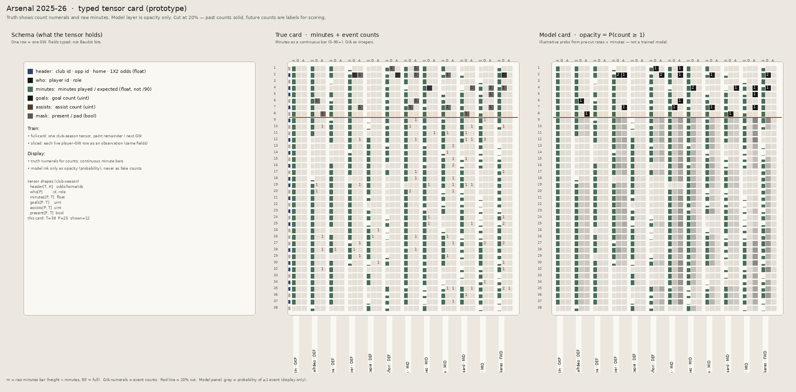

# This is the card

**Locked design (cemented).** The flashcard is a typed tensor for one club-season.
Opacity is only a *display* of event probability — not the storage format.
Baudot binary bit-planes are **retired for training**.

## Schema (`src/models/tensor_card.py`)

| Field | Shape | Type | Note |
| --- | --- | --- | --- |
| `header` via `gw`, `home`, `opp_id`, `odds_1x2` | `[T, …]` | ids / bool / float | assessed club-win / draw / opp-win |
| `who` via `player_id`, `position`, `names` | `[P]` | id / role / str | seats padded to 40 |
| `minutes` | `[P, T]` | float | **raw minutes**, not `/90` |
| `goals` | `[P, T]` | uint | **unclipped** event counts |
| `assists` | `[P, T]` | uint | **unclipped** event counts |
| `present` | `[P, T]` | bool | row exists that week |

Paint / model output is **opacity** \(= P(\text{count} \ge 1)\). Numerals on the truth card show the uint counts.

## Training FOVs (same tensor)

1. **Sliced spine** — player–GW rows with strictly as-of history (`iter_slices` / `asof_inputs`). Baselines live here.
2. **Full-card stepped** — past truth visible; blank events from the painted GW onward; score that week.
3. **Full-card horizon** — blank G/A beyond the cut; one-shot remainder; score every live remainder cell equally (no per-player column strip).

Seat shuffle each batch so identity is not a fixed row index. Header and minutes stay visible under FOV blanks.

## Explicit as-of fields (current)

- Opponent id + assessed odds in the header.
- Player history means / last / last-5 from weeks `< t`.
- Teammate shared-minutes on the scored week (`mate_minutes`, `mate_n`) as a slice-level shared-minutes signal.

Deferred (not blocking cement): expected minutes on future inputs; richer opp-history tensor; optional count head; survival as experiment two.

## Prototype

## Baselines

See [`typed_tensor_card_baselines.md`](typed_tensor_card_baselines.md).

## Stepped FOV screen (2026-11-15)

Full-card stepped painter: [`typed_tensor_stepped.md`](typed_tensor_stepped.md).
Holdout d1 log 0.1689 vs sliced logistic 0.1497 — **screen loss**. Card design stays.
