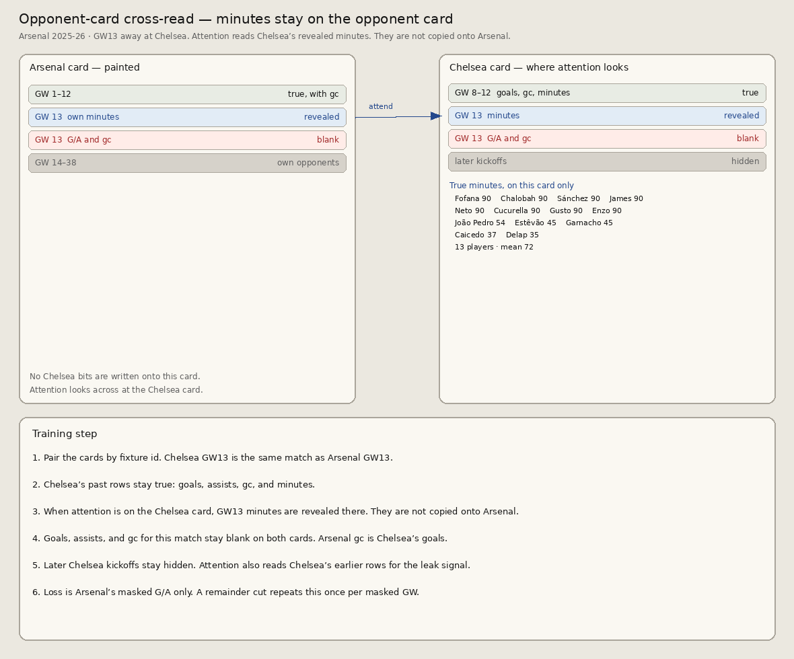

# Opponent-card cross-read (training step)

One masked GW on the club being painted attends over the opponent card. Minutes for that GW stay revealed on the opponent card. They are not copied onto the painted card. Illustrated on Arsenal 2025-26 GW13 away at Chelsea.

## Rule

1. Pair club-season cards by fixture id.
2. Opponent rows with an earlier kickoff stay true: goals, assists, gc, and minutes.
3. When attention is on the opponent card, minutes for this fixture are revealed there. They are not written onto the Arsenal card.
4. Goals, assists, and gc for this match stay blank on both cards. Arsenal’s gc that week is Chelsea’s goals.
5. Later opponent kickoffs stay hidden. Attention still reads the opponent’s earlier rows.
6. Loss is the painted club’s masked G/A only. A remainder cut repeats the step once per masked GW, each with its own opponent.

Chelsea GW13 minutes, visible only on the Chelsea card: 13 players, mean 72. Fofana, Chalobah, Sánchez, James, Neto, Cucurella, Gusto, and Enzo 90; João Pedro 54; Estêvão 45; Garnacho 45; Caicedo 37; Delap 35.
