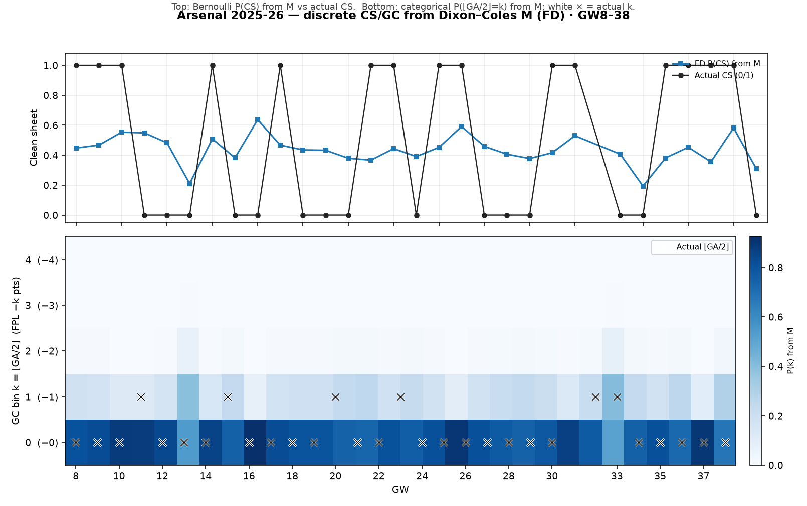

# Arsenal 2025-26 — discrete CS/GC from M (FD)

Visual companion to the promoted same-skeleton screen:
Bernoulli `P(CS)` and categorical `P(⌊GA/2⌋=k)` from Dixon–Coles `M`.



| | mean |
| --- | ---: |
| FD P(CS) | 0.436 |
| Actual CS rate | 0.500 |
| FD E[⌊GA/2⌋] | 0.230 |
| Actual mean ⌊GA/2⌋ | 0.200 |

```bash
PYTHONPATH=. python3 -m src.eval.plot_arsenal_discrete_from_m --season 2025-26
```
