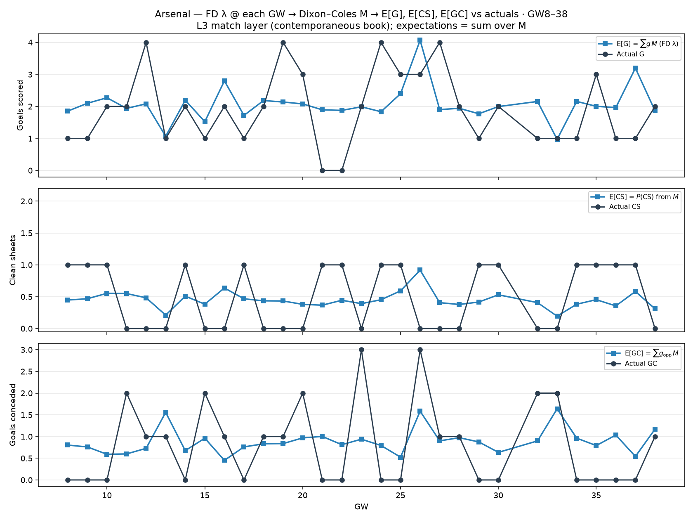

# Arsenal — FD λ → Dixon–Coles M expectations vs actuals (GW8–38)

Contemporaneous football-data centreline λ at each GW → `M` →
`E[G]=Σ g M`, `E[CS]=P(CS)`, `E[GC]=Σ g_opp M`.

| | Σ E from M | Σ actual |
| --- | ---: | ---: |
| G | 61.9 | 57 |
| CS | 13.5 | 15 |
| GC | 26.6 | 24 |
