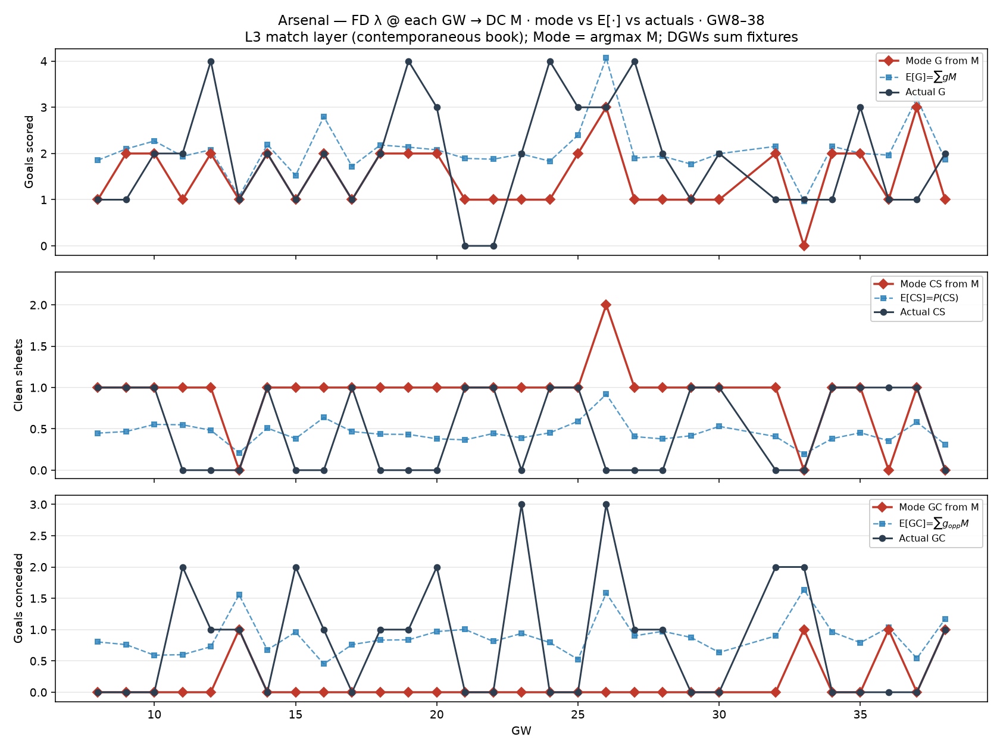

# Arsenal — FD λ @ GW(t) → DC M mode scoreline vs actuals (GW8–38)

Same construction as the Opta mode plot, but λ comes from **football-data
centreline at each target GW** (the L3 match layer when the book is priced).

| | Σ mode | Σ E[·] | Σ actual |
| --- | ---: | ---: | ---: |
| G | 45 | 61.9 | 57 |
| CS | 27 | 13.5 | 15 |
| GC | 4 | 26.6 | 24 |

Red = mode; blue dashed = E under M; black = actual.
