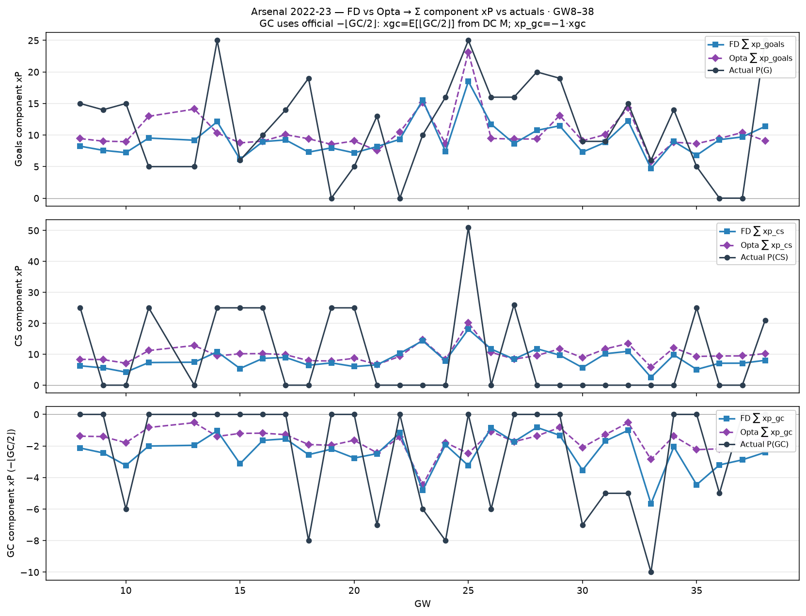

# Arsenal 2022-23 — FD/Opta → component xP vs actuals (GW8–38)

Club Dixon–Coles moments → `score_team_side` → Σ Arsenal `xp_goals` / `xp_cs` / `xp_gc`.
Actuals = Σ Arsenal FPL P(G)/P(CS)/P(GC).

**GC (official):** `xgc = E[⌊GC/2⌋]` from `team_moments`; `xp_gc = −1 · xgc`
(matches `goals_conceded_points` / −1 per two goals).

| | Σ FD xP | Σ Opta xP | Σ actual P | MAE FD | MAE Opta |
| --- | ---: | ---: | ---: | ---: | ---: |
| G | 281.4 | 311.7 | 351 | 5.96 | 6.16 |
| CS | 249.5 | 301.6 | 298 | 12.17 | 12.39 |
| GC | -71.9 | -50.0 | -73 | 2.77 | 2.61 |
