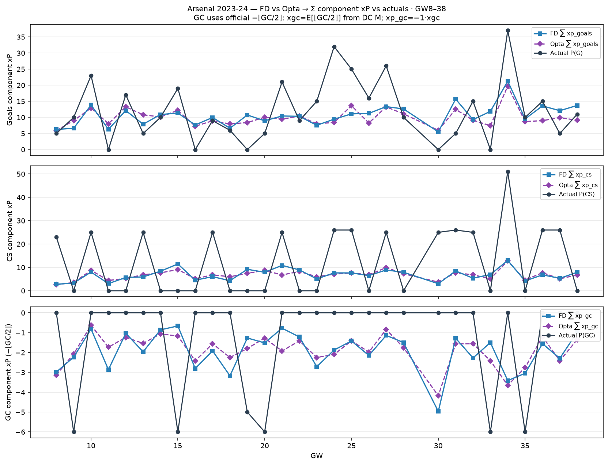

# Arsenal 2023-24 — FD/Opta → component xP vs actuals (GW8–38)

Club Dixon–Coles moments → `score_team_side` → Σ Arsenal `xp_goals` / `xp_cs` / `xp_gc`.
Actuals = Σ Arsenal FPL P(G)/P(CS)/P(GC).

**GC (official):** `xgc = E[⌊GC/2⌋]` from `team_moments`; `xp_gc = −1 · xgc`
(matches `goals_conceded_points` / −1 per two goals).

| | Σ FD xP | Σ Opta xP | Σ actual P | MAE FD | MAE Opta |
| --- | ---: | ---: | ---: | ---: | ---: |
| G | 317.8 | 298.9 | 361 | 6.58 | 6.46 |
| CS | 205.0 | 202.4 | 379 | 12.82 | 12.69 |
| GC | -58.2 | -56.6 | -35 | 2.42 | 2.29 |
