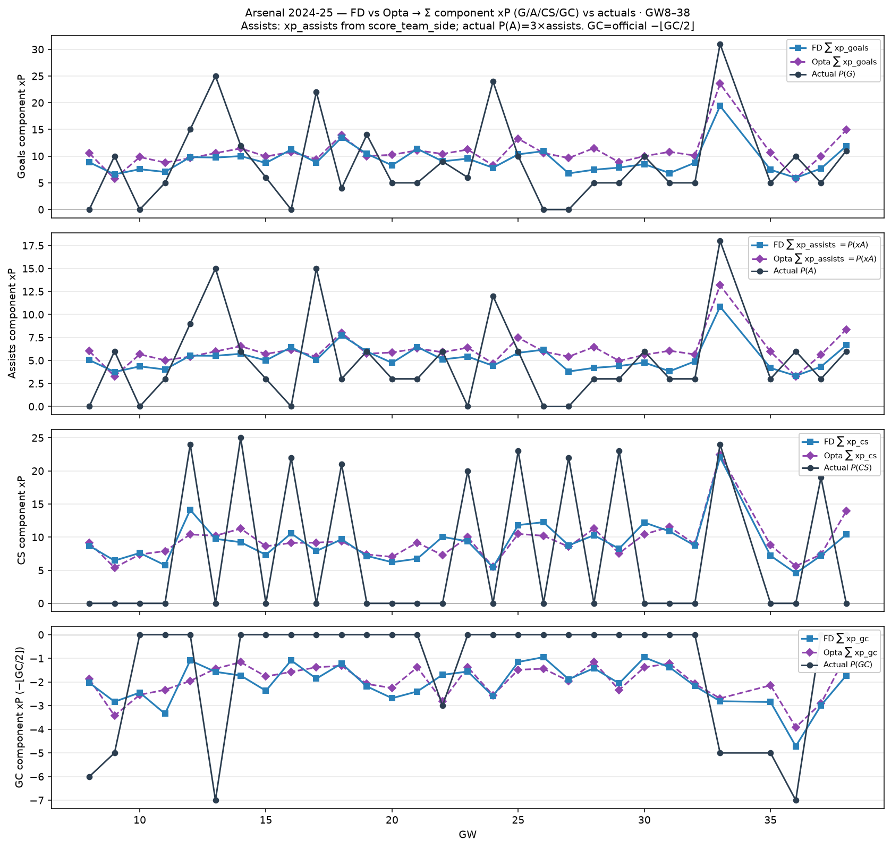

# Arsenal 2024-25 — FD/Opta → component xP vs actuals (GW8–38)

Club Dixon–Coles moments → `score_team_side` → Σ Arsenal `xp_goals` / `xp_assists` /
`xp_cs` / `xp_gc`. Actuals = Σ Arsenal FPL P(G)/P(A)/P(CS)/P(GC).

- **Assists:** `P(xA)=Σ xp_assists`; `P(A)=3×assists`.
- **GC:** `xgc=E[⌊GC/2⌋]`; `xp_gc=−1·xgc`.

| | Σ FD xP | Σ Opta xP | Σ actual P | MAE FD | MAE Opta |
| --- | ---: | ---: | ---: | ---: | ---: |
| G | 278.0 | 321.6 | 264 | 5.53 | 6.49 |
| A | 157.5 | 182.1 | 150 | 3.26 | 3.77 |
| CS | 276.6 | 281.5 | 223 | 9.25 | 9.71 |
| GC | -61.8 | -58.8 | -38 | 2.09 | 2.01 |
