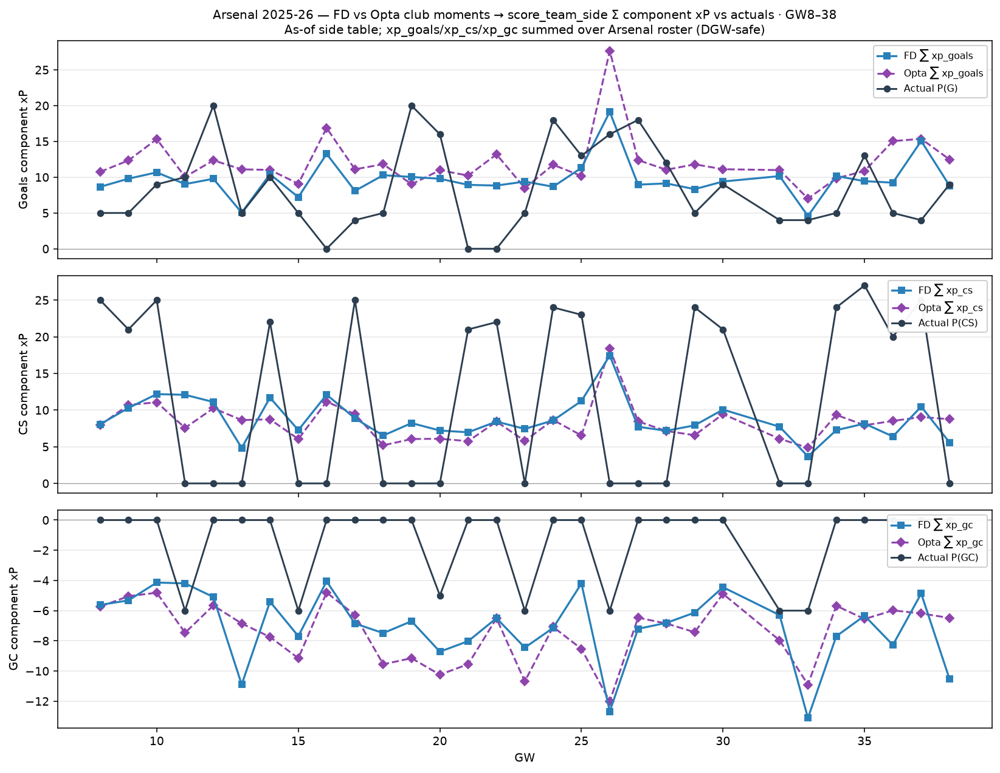

# Arsenal 2025-26 — FD/Opta → component xP vs actuals (GW8–38)

Club E[G]/E[CS]/E[GC] from Dixon–Coles `M` → `score_team_side` → Σ Arsenal
`xp_goals` / `xp_cs` / `xp_gc`. Actuals = Σ Arsenal FPL P(G)/P(CS)/P(GC).

| | Σ FD xP | Σ Opta xP | Σ actual P | MAE FD | MAE Opta |
| --- | ---: | ---: | ---: | ---: | ---: |
| G | 291.6 | 361.2 | 254 | 4.86 | 6.34 |
| CS | 262.7 | 248.6 | 349 | 11.28 | 11.38 |
| GC | -210.9 | -222.3 | -41 | 5.78 | 6.04 |

Note: mean-layer `xp_gc = −1 · xGC` (linear); official P(GC) is `−⌊GC/2⌋` for GKP/DEF.
