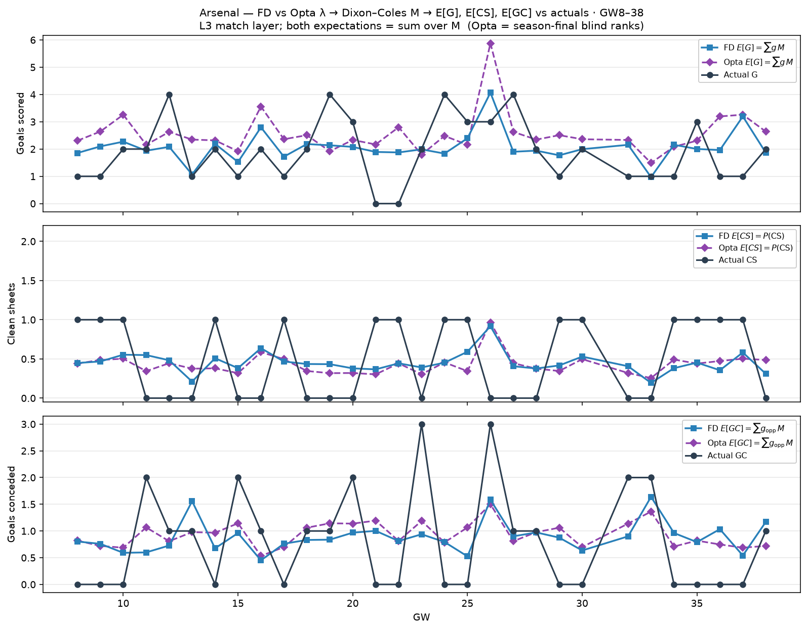

# Arsenal — FD vs Opta λ → Dixon–Coles M expectations (GW8–38)

Contemporaneous FD centreline λ and Opta season-final blind ranks → `M` →
`E[G]=Σ g M`, `E[CS]=P(CS)`, `E[GC]=Σ g_opp M`, overlaid vs actuals.

| | Σ FD E | Σ Opta E | Σ actual |
| --- | ---: | ---: | ---: |
| G | 61.9 | 76.7 | 57 |
| CS | 13.5 | 12.8 | 15 |
| GC | 26.6 | 28.1 | 24 |
