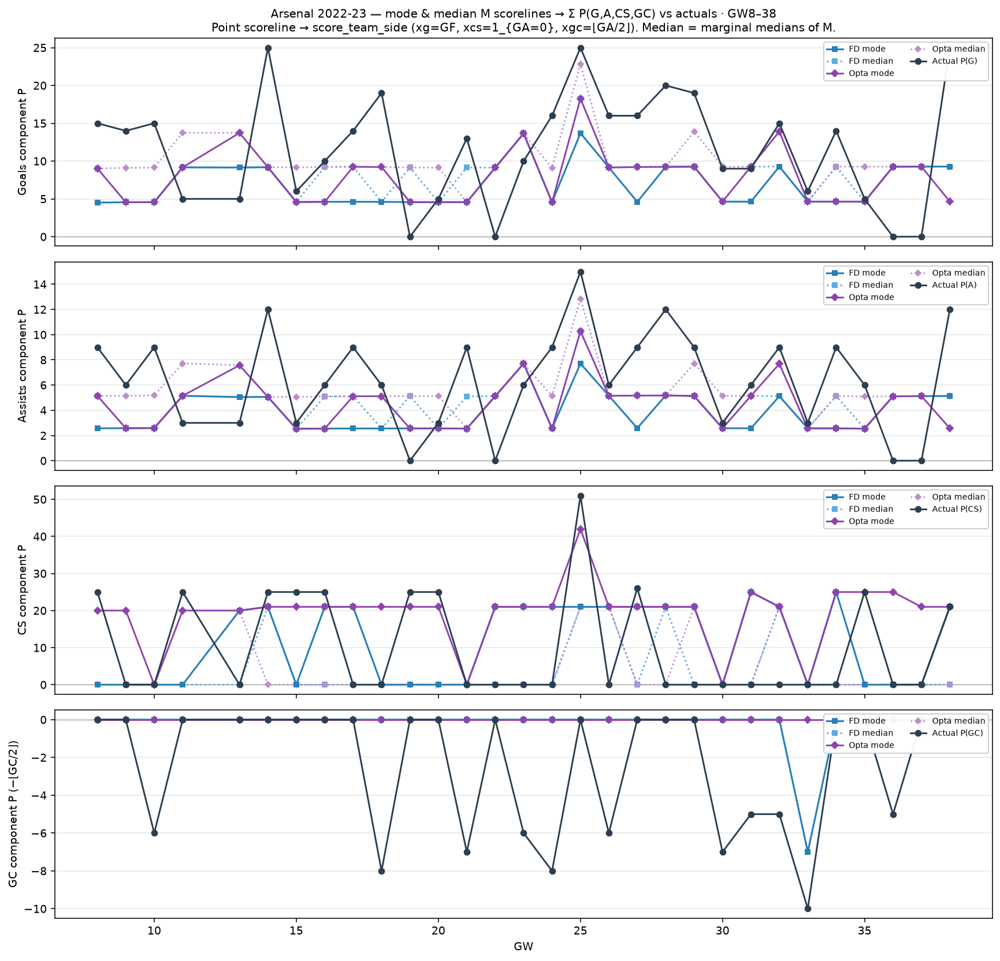

# Arsenal 2022-23 — mode & median M → component P vs actuals (GW8–38)

Dixon–Coles mode (`argmax M`) and marginal-median scorelines → point moments →
`score_team_side` Σ Arsenal P(G)/P(A)/P(CS)/P(GC).

| | MAE FD mode | MAE FD med | MAE Opta mode | MAE Opta med |
| --- | ---: | ---: | ---: | ---: |
| G | 7.75 | 6.70 | 7.00 | 6.26 |
| A | 4.14 | 3.55 | 3.71 | 3.28 |
| CS | 14.37 | 10.63 | 12.30 | 11.33 |
| GC | 2.20 | 2.20 | 2.43 | 2.43 |
