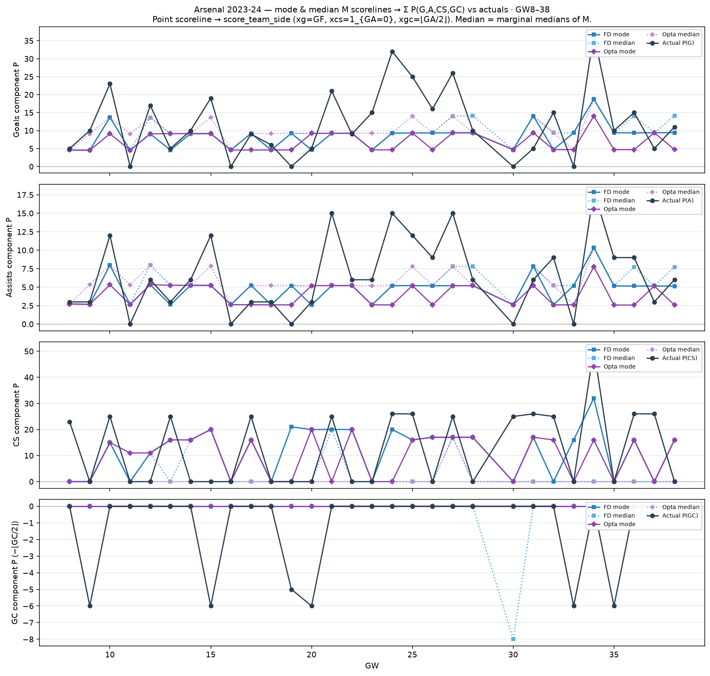

# Arsenal 2023-24 — mode & median M → component P vs actuals (GW8–38)

Dixon–Coles mode (`argmax M`) and marginal-median scorelines → point moments →
`score_team_side` Σ Arsenal P(G)/P(A)/P(CS)/P(GC).

| | MAE FD mode | MAE FD med | MAE Opta mode | MAE Opta med |
| --- | ---: | ---: | ---: | ---: |
| G | 6.77 | 6.57 | 7.79 | 6.00 |
| A | 3.54 | 3.51 | 3.99 | 3.40 |
| CS | 12.27 | 12.47 | 12.73 | 11.57 |
| GC | 1.17 | 1.43 | 1.17 | 1.17 |
