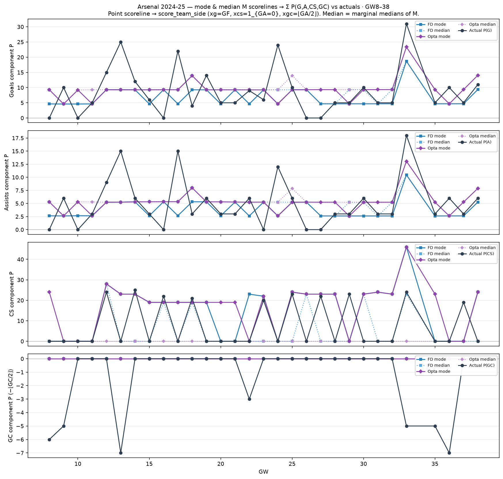

# Arsenal 2024-25 — mode & median M → component P vs actuals (GW8–38)

Dixon–Coles mode (`argmax M`) and marginal-median scorelines → point moments →
`score_team_side` Σ Arsenal P(G)/P(A)/P(CS)/P(GC).

| | MAE FD mode | MAE FD med | MAE Opta mode | MAE Opta med |
| --- | ---: | ---: | ---: | ---: |
| G | 5.00 | 5.17 | 5.93 | 6.14 |
| A | 3.03 | 3.11 | 3.51 | 3.58 |
| CS | 10.73 | 6.27 | 12.80 | 8.23 |
| GC | 1.27 | 1.27 | 1.27 | 1.27 |
