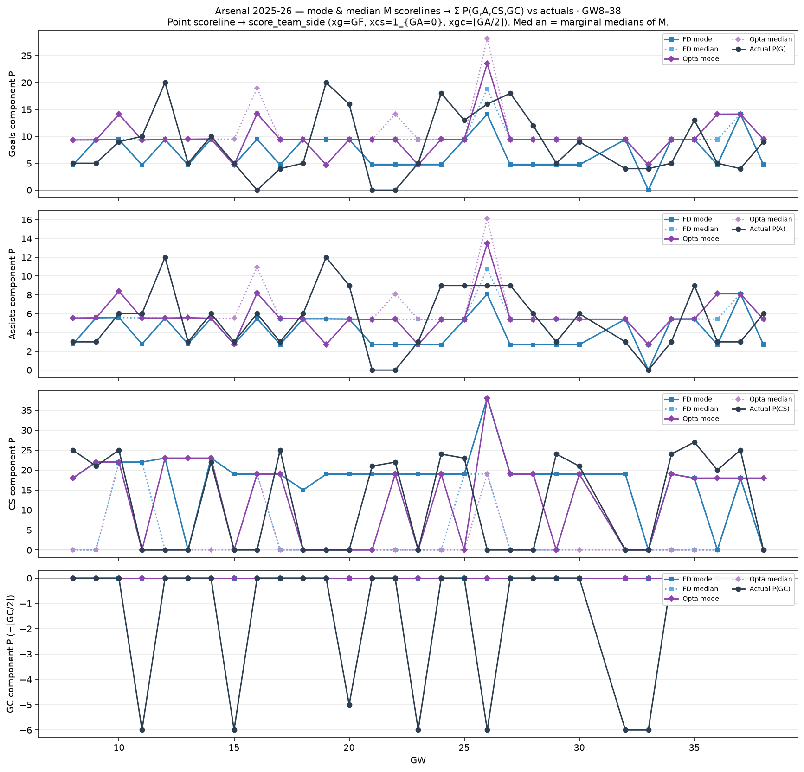

# Arsenal 2025-26 — mode & median M → component P vs actuals (GW8–38)

Dixon–Coles mode (`argmax M`) and marginal-median scorelines → point moments →
`score_team_side` Σ Arsenal P(G)/P(A)/P(CS)/P(GC).

| | MAE FD mode | MAE FD med | MAE Opta mode | MAE Opta med |
| --- | ---: | ---: | ---: | ---: |
| G | 4.65 | 4.87 | 5.49 | 6.09 |
| A | 2.41 | 2.58 | 2.93 | 3.25 |
| CS | 11.00 | 10.33 | 9.27 | 11.57 |
| GC | 1.37 | 1.37 | 1.37 | 1.37 |
