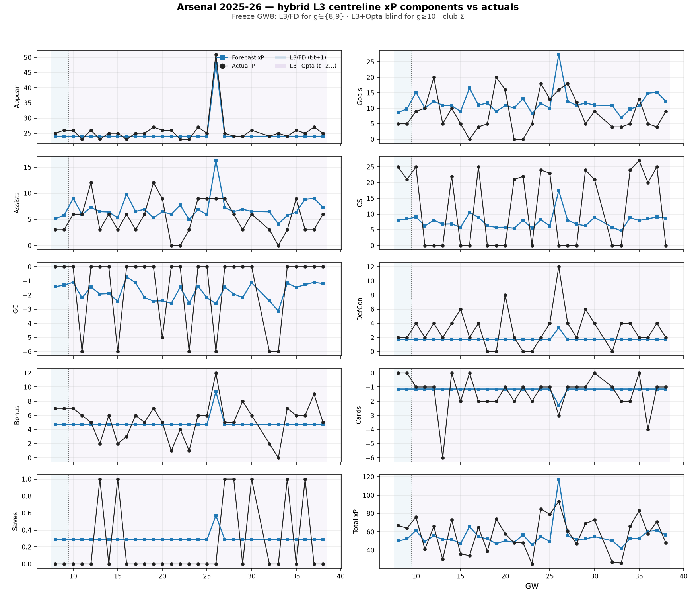

# Arsenal 2025-26 — hybrid L3 component xP vs actuals

Freeze **GW8**: L3/FD for `g∈{8,9}`; L3+Opta blind for `g≥10` (locked `l3_centreline_forecast`).



| Component | Σ forecast | Σ actual | MAE/GW |
| --- | ---: | ---: | ---: |
| Appear | 744.0 | 775.0 | 1.37 |
| Goals | 352.9 | 254.0 | 6.12 |
| Assists | 209.4 | 159.0 | 3.25 |
| CS | 230.5 | 349.0 | 11.40 |
| GC | -53.7 | -41.0 | 1.97 |
| DefCon | 52.3 | 94.0 | 1.95 |
| Bonus | 145.0 | 157.0 | 1.90 |
| Cards | -35.4 | -42.0 | 0.80 |
| Saves | 8.9 | 7.0 | 0.40 |
| Total xP | 1653.8 | 1730.0 | 15.61 |

| Band | n GW | Σ xP | Σ actual |
| --- | ---: | ---: | ---: |
| L3/FD (t:t+1) | 2 | 102.2 | 131.0 |
| L3+Opta (t+2…) | 28 | 1551.7 | 1599.0 |

```bash
PYTHONPATH=. python3 -m src.eval.plot_l3_hybrid_component_xp_team --season 2025-26 --team 'Arsenal' --freeze-gw 8 --horizon-end 38
```
