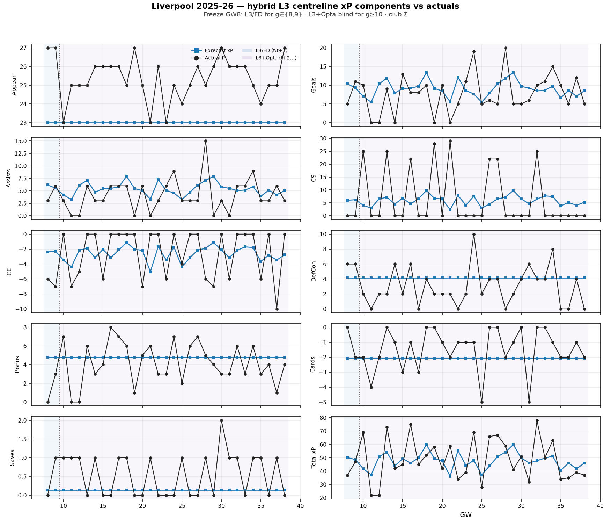

# Liverpool 2025-26 — hybrid L3 component xP vs actuals

Freeze **GW8**: L3/FD for `g∈{8,9}`; L3+Opta blind for `g≥10` (locked `l3_centreline_forecast`).



| Component | Σ forecast | Σ actual | MAE/GW |
| --- | ---: | ---: | ---: |
| Appear | 713.0 | 787.0 | 2.39 |
| Goals | 280.4 | 239.0 | 4.53 |
| Assists | 166.8 | 129.0 | 2.66 |
| CS | 182.4 | 198.0 | 9.53 |
| GC | -80.7 | -83.0 | 2.95 |
| DefCon | 128.0 | 96.0 | 2.26 |
| Bonus | 149.1 | 126.0 | 2.00 |
| Cards | -64.4 | -45.0 | 1.25 |
| Saves | 4.4 | 17.0 | 0.54 |
| Total xP | 1479.1 | 1510.0 | 12.78 |

| Band | n GW | Σ xP | Σ actual |
| --- | ---: | ---: | ---: |
| L3/FD (t:t+1) | 2 | 98.9 | 84.0 |
| L3+Opta (t+2…) | 29 | 1380.3 | 1426.0 |

```bash
PYTHONPATH=. python3 -m src.eval.plot_l3_hybrid_component_xp_team --season 2025-26 --team 'Liverpool' --freeze-gw 8 --horizon-end 38
```
