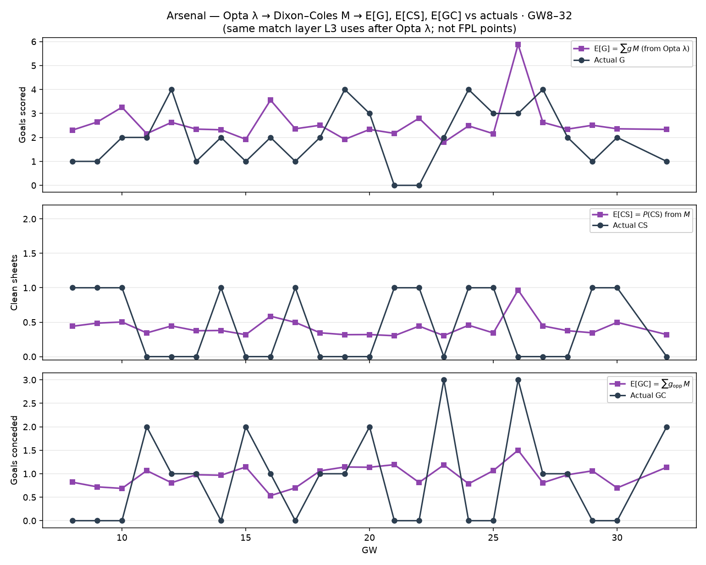

# Arsenal — Opta λ → Dixon–Coles M vs actuals (GW8–32)

Match layer only (what L3 consumes after Opta λ):

1. Opta place λ (blind)
2. Dixon–Coles matrix `M`
3. `E[G] = Σ g M`, `E[CS] = P(CS)`, `E[GC] = Σ g_opp M`

| | Σ E from M | Σ actual |
| --- | ---: | ---: |
| G | 61.7 | 48 |
| CS | 10.2 | 11 |
| GC | 23.0 | 21 |

Raw λ totals for reference: Σλ_G=62.4, Σλ_opp=23.0
(mean |E[G]−λ|=0.0298 — truncation).
