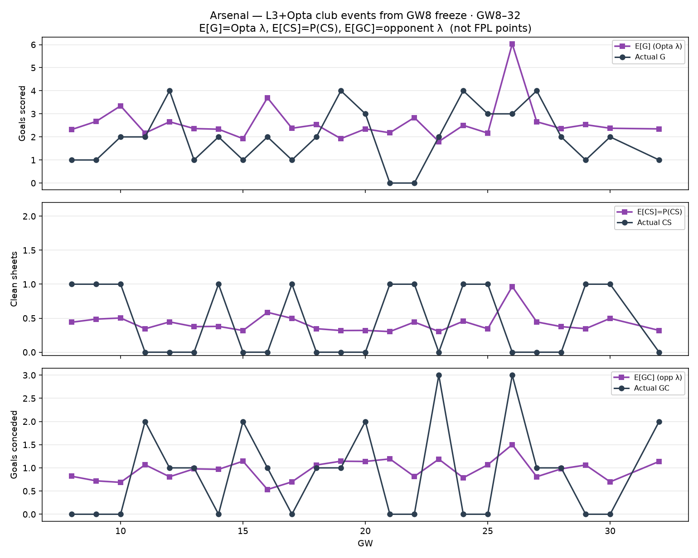

# Arsenal club events — L3+Opta E[G], E[CS], E[GC] vs actuals (GW8–32)

Not FPL points. Club-match expectations from the Opta blind centreline λ used by the L3+Opta path (GW8 freeze ranks / place GF/GA; same λ every freeze — place-locked).

| quantity | definition |
| --- | --- |
| **E[G]** | Opta λ for Arsenal that fixture (sum if DGW) |
| **Actual G** | goals scored |
| **E[CS]** | Dixon–Coles P(CS) |
| **Actual CS** | 1 if conceded 0 (count if DGW) |
| **E[GC]** | opponent λ |
| **Actual GC** | goals conceded |

| | Σ G | Σ CS | Σ GC |
| --- | ---: | ---: | ---: |
| E[·] (Opta) | 62.4 | 10.2 | 23.0 |
| Actual | 48 | 11 | 21 |

GW26 = DGW (two fixtures).
