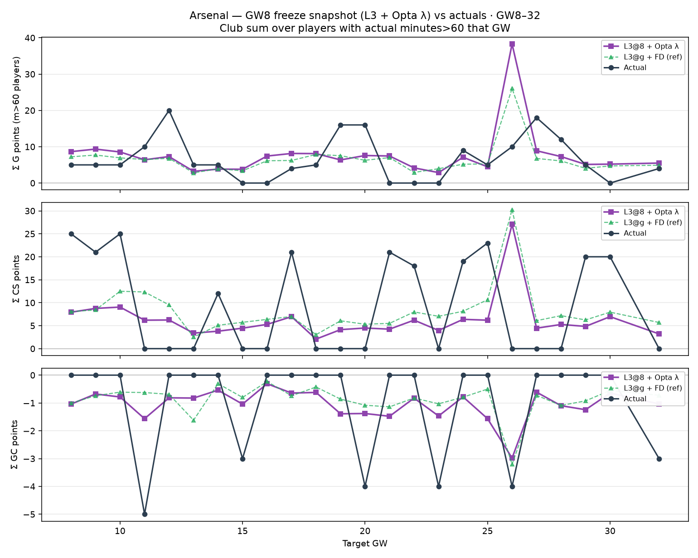

# Arsenal snapshot — L3@8 + Opta λ vs actuals (GW8–32)

Freeze at **decision GW8**: L3 centreline rates/shares as-of before GW8, Opta blind λ for each target GW. Club totals = sum over Arsenal players with **actual minutes > 60** that GW (same residual pool as the horizon screen).

| | Σ G | Σ CS | Σ GC |
| --- | ---: | ---: | ---: |
| L3@8 + Opta λ | 185.1 | 151.5 | −25.4 |
| Actual | 159.0 | 225.0 | −23.0 |

- G: Opta freeze **overprints** (~+26 pts over the window).
- CS: Opta freeze **underprints** badly vs a strong Arsenal CS run (151 vs 225).
- GW26 spike = DGW (more m>60 rows).
- Green dashed = contemporaneous L3@g + FD (reference, not available at freeze).

CSV: `reports/l3_opta_arsenal_gw8_freeze_gw8-32.csv`
