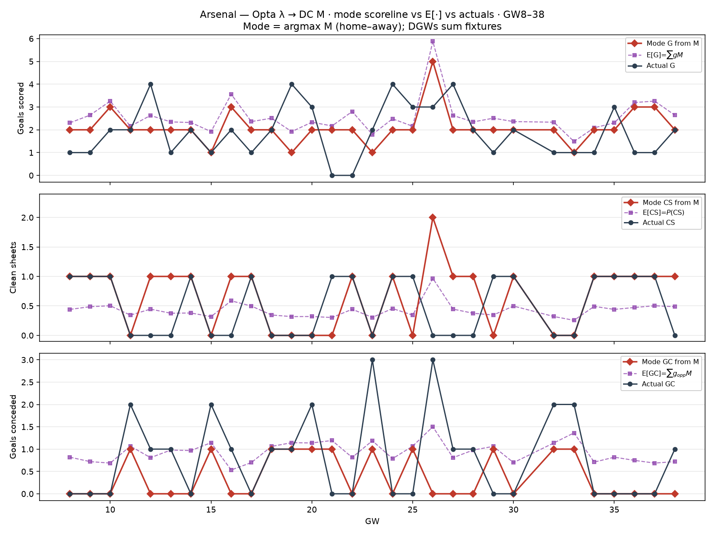

# Arsenal — mode scoreline from DC M vs actuals (GW8–38)

For each fixture: Opta blind λ → Dixon–Coles `M` → **mode** = argmax `M`.
Arsenal G/CS/GC taken from that scoreline (DGWs summed).

| | Σ mode | Σ E[·] | Σ actual |
| --- | ---: | ---: | ---: |
| G | 63 | 76.7 | 57 |
| CS | 20 | 12.8 | 15 |
| GC | 11 | 28.1 | 24 |

Red = mode; purple dashed = E under M; black = actual.
