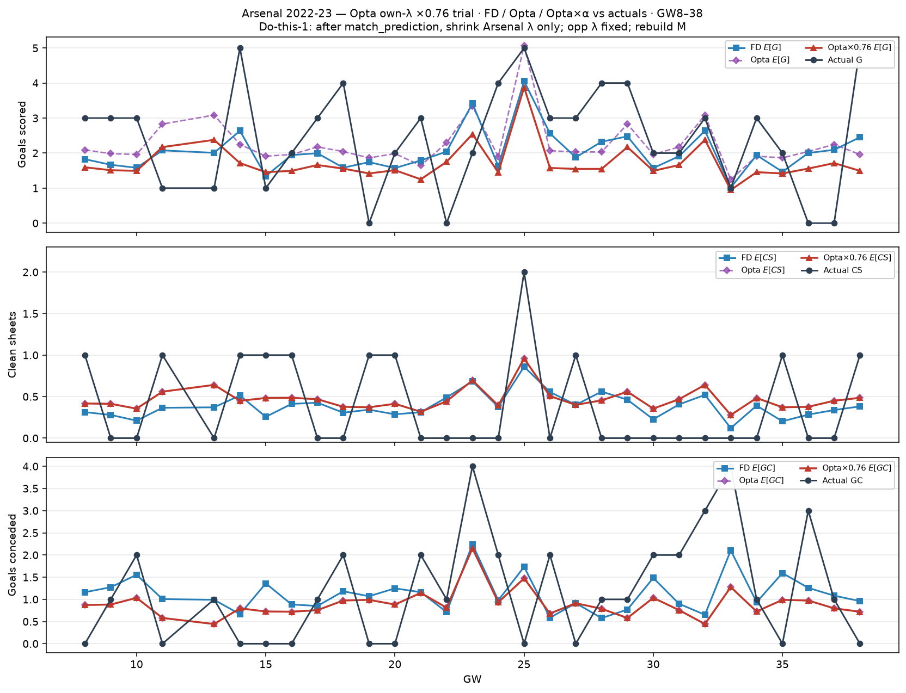

# Arsenal 2022-23 — Opta own-λ ×0.76 trial (GW8–38)

After `match_prediction`, Arsenal-side λ × 0.76; opponent λ unchanged; rebuild Dixon–Coles `M`.

| | Σ FD E | Σ Opta E | Σ Opta×0.76 | Σ actual |
| --- | ---: | ---: | ---: | ---: |
| G | 61.2 | 67.8 | 51.8 | 74 |
| CS | 11.7 | 14.1 | 14.1 | 12 |
| GC | 33.9 | 26.9 | 26.9 | 36 |
