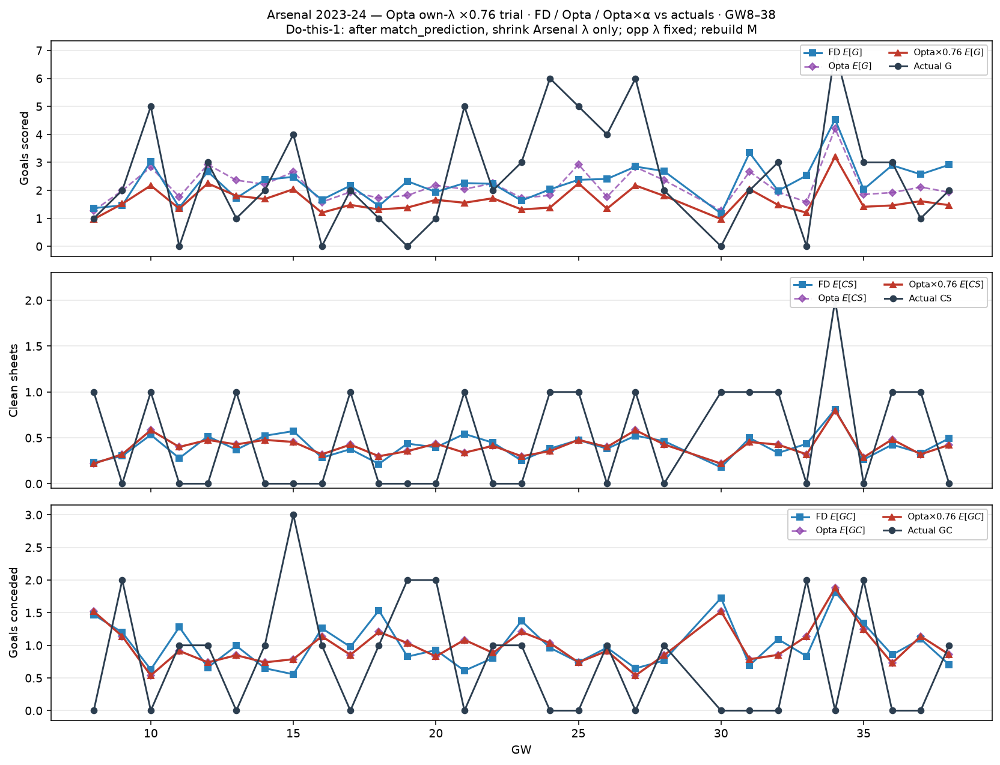

# Arsenal 2023-24 — Opta own-λ ×0.76 trial (GW8–38)

After `match_prediction`, Arsenal-side λ × 0.76; opponent λ unchanged; rebuild Dixon–Coles `M`.

| | Σ FD E | Σ Opta E | Σ Opta×0.76 | Σ actual |
| --- | ---: | ---: | ---: | ---: |
| G | 68.5 | 64.5 | 49.3 | 76 |
| CS | 12.3 | 12.2 | 12.2 | 15 |
| GC | 30.0 | 29.7 | 29.7 | 23 |
