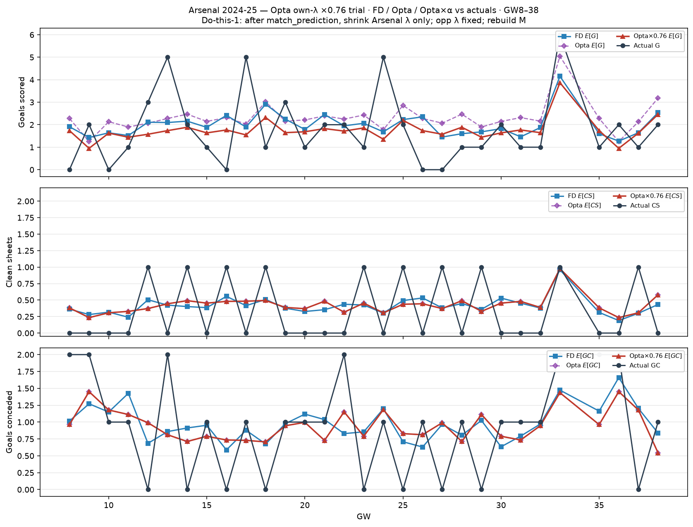

# Arsenal 2024-25 — Opta own-λ ×0.76 trial (GW8–38)

After `match_prediction`, Arsenal-side λ × 0.76; opponent λ unchanged; rebuild Dixon–Coles `M`.

| | Σ FD E | Σ Opta E | Σ Opta×0.76 | Σ actual |
| --- | ---: | ---: | ---: | ---: |
| G | 59.8 | 69.2 | 52.9 | 54 |
| CS | 12.4 | 12.7 | 12.7 | 10 |
| GC | 29.3 | 28.5 | 28.5 | 28 |
