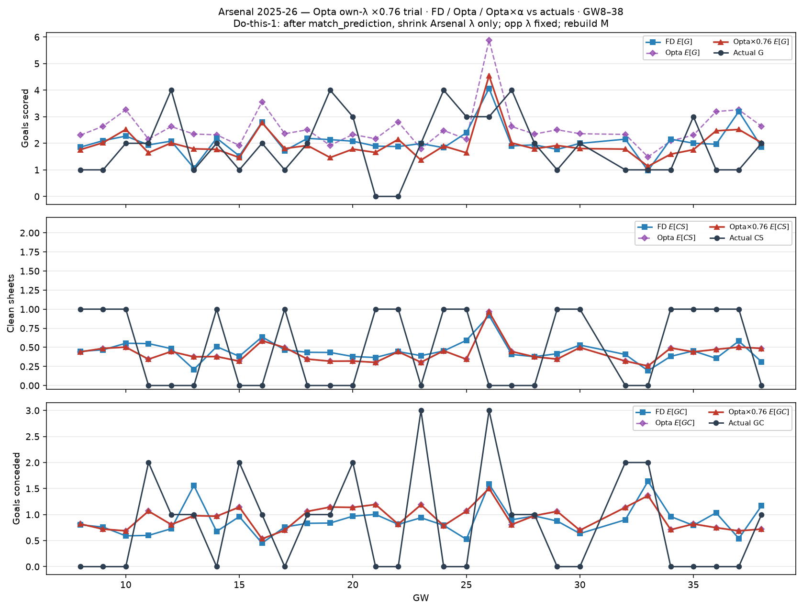

# Arsenal 2025-26 — Opta own-λ ×0.76 trial (GW8–38)

After `match_prediction`, Arsenal-side λ × 0.76; opponent λ unchanged; rebuild Dixon–Coles `M`.

| | Σ FD E | Σ Opta E | Σ Opta×0.76 | Σ actual |
| --- | ---: | ---: | ---: | ---: |
| G | 61.9 | 76.7 | 58.8 | 57 |
| CS | 13.5 | 12.8 | 12.8 | 15 |
| GC | 26.6 | 28.1 | 28.1 | 24 |
