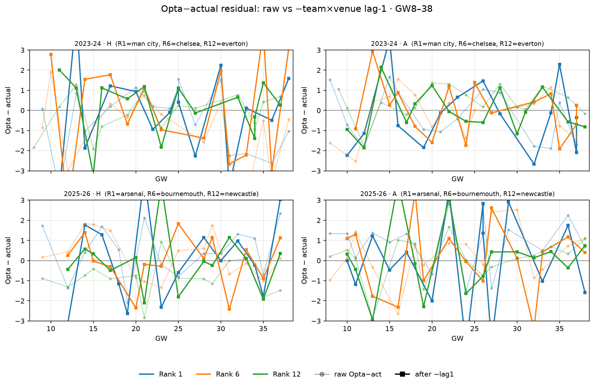

# Lag-1 correction using Opta − actual (not FD)

`λ'_t = λ_Opta,t − (Opta − actual)_{t−1}` (team×venue primary).

## vs actual (pooled, n with team×venue lag)

| arm | bias | MAE | RMSE | bias H | bias A |
| --- | ---: | ---: | ---: | ---: | ---: |
| raw Opta | -0.007 | 0.951 | 1.203 | -0.133 | +0.119 |
| − team×venue (Opta−act)_{t-1} | +0.002 | 1.289 | 1.652 | +0.005 | -0.001 |
| − team any (Opta−act)_{t-1} | +0.004 | 1.275 | 1.640 | -0.181 | +0.190 |
| − league venue GW(t-1) | +0.012 | 0.995 | 1.247 | +0.020 | +0.004 |
| FD reference | +0.018 | 0.944 | 1.186 | +0.052 | -0.017 |

## Head-to-head vs FD-lag (same rows)

| arm | MAE vs act |
| --- | ---: |
| raw Opta | 0.951 |
| Opta−actual lag-1 | 1.289 |
| Opta−FD lag-1 | 0.964 |
| FD | 0.944 |

## Verdict

- Opta−actual autocorr (team×venue): 2022-23 +0.063, 2023-24 +0.036, 2024-25 +0.069, 2025-26 +0.005 (mean +0.043) — much weaker than Opta−FD (~0.6–0.7).
- Team×venue act-lag: MAE vs act 0.951 → **1.289** (bias -0.007 → +0.002).
- vs FD-lag on same rows: act-lag MAE **1.289** vs FD-lag **0.964** (raw 0.951).

