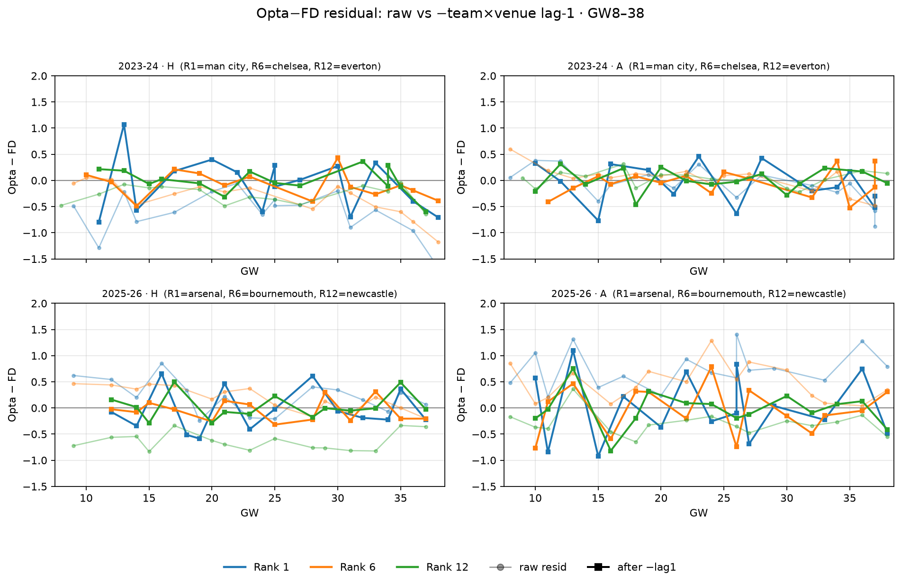

# Lag-1 Opta−FD residual correction (causal, updates each GW)

For each team-side at GW t, subtract the previous Opta−FD residual, then re-score vs FD and vs actual.

## Schemes

1. **team × venue lag-1** — previous match for that club at the same H/A (primary / “respective λ_H, λ_A”).
2. **team any-venue lag-1** — previous match for that club regardless of venue.
3. **league venue GW(t−1)** — mean home/away residual across the league in the previous GW.

Corrected: `λ'_t = λ_Opta,t − resid_{t−1}`.

## Pooled (rows with team×venue lag)

| arm | resid vs FD | H | A | MAE vs FD | bias vs act | MAE vs act |
| --- | ---: | ---: | ---: | ---: | ---: | ---: |
| raw Opta | -0.025 | -0.185 | +0.135 | 0.296 | -0.007 | 0.951 |
| − team×venue lag1 | -0.012 | -0.015 | -0.010 | 0.242 | +0.005 | 0.964 |
| − team any lag1 | -0.007 | -0.262 | +0.247 | 0.336 | +0.010 | 0.975 |
| − league venue GW(t-1) | -0.007 | -0.012 | -0.003 | 0.268 | +0.010 | 0.950 |
| FD reference | 0 | 0 | 0 | 0 | +0.018 | 0.944 |

## By season (team × venue lag-1)

| season | raw resid | corr resid | raw H/A | corr H/A | MAE_act raw | MAE_act corr |
| --- | ---: | ---: | ---: | ---: | ---: | ---: |
| 2022-23 | +0.088 | -0.007 | -0.06/+0.24 | -0.01/-0.00 | 0.958 | 0.956 |
| 2023-24 | -0.173 | -0.027 | -0.33/-0.02 | -0.03/-0.02 | 0.974 | 0.995 |
| 2024-25 | -0.080 | -0.001 | -0.25/+0.09 | -0.00/-0.00 | 0.946 | 0.965 |
| 2025-26 | +0.063 | -0.014 | -0.10/+0.23 | -0.02/-0.01 | 0.925 | 0.940 |

## Verdict

- **Team×venue lag-1:** resid vs FD -0.025 → **-0.012**; MAE vs FD 0.296 → **0.242**; MAE vs act 0.951 → **0.964**.
- **League venue GW(t−1):** resid -0.025 → **-0.007**; MAE vs act 0.951 → **0.950**.

