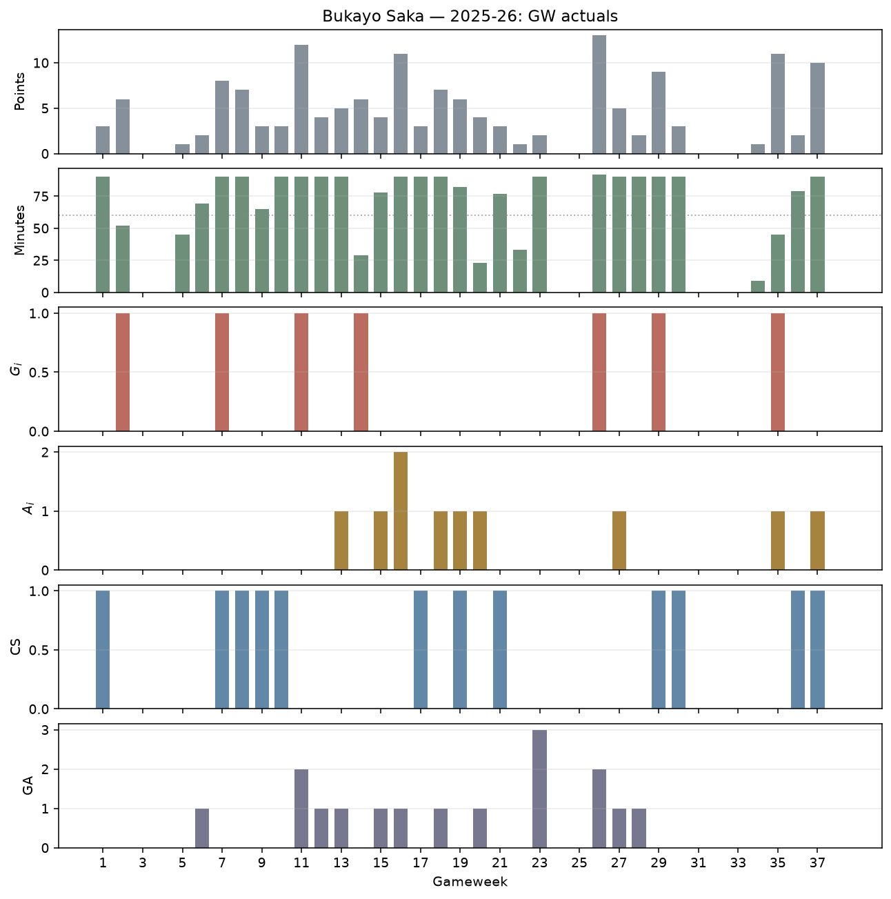

# Player GW actuals — Bukayo Saka (2025-26)

Scorer-simplify dig: bar plots of GW actuals only (points, minutes, $G_i$, $A_i$, CS, GA). No expanding overlay.

## Snapshot rows

| GW | total_points | minutes | goals | assists | clean_sheets | goals_conceded |
| --- | --- | --- | --- | --- | --- | --- |
| 1 | 3.00 | 90.00 | 0.00 | 0.00 | 1.00 | 0.00 |
| 5 | 1.00 | 45.00 | 0.00 | 0.00 | 0.00 | 0.00 |
| 10 | 3.00 | 90.00 | 0.00 | 0.00 | 1.00 | 0.00 |
| 15 | 4.00 | 78.00 | 0.00 | 1.00 | 0.00 | 1.00 |
| 20 | 4.00 | 23.00 | 0.00 | 1.00 | 0.00 | 1.00 |
| 25 | 0.00 | 0.00 | 0.00 | 0.00 | 0.00 | 0.00 |
| 30 | 3.00 | 90.00 | 0.00 | 0.00 | 1.00 | 0.00 |
| 35 | 11.00 | 45.00 | 1.00 | 1.00 | 0.00 | 0.00 |
| 38 | 0.00 | 0.00 | 0.00 | 0.00 | 0.00 | 0.00 |

Full CSV: `/agent/repos/fpl-engine/data/processed/player_expanding_view_bukayo_saka_2025_26.csv`

