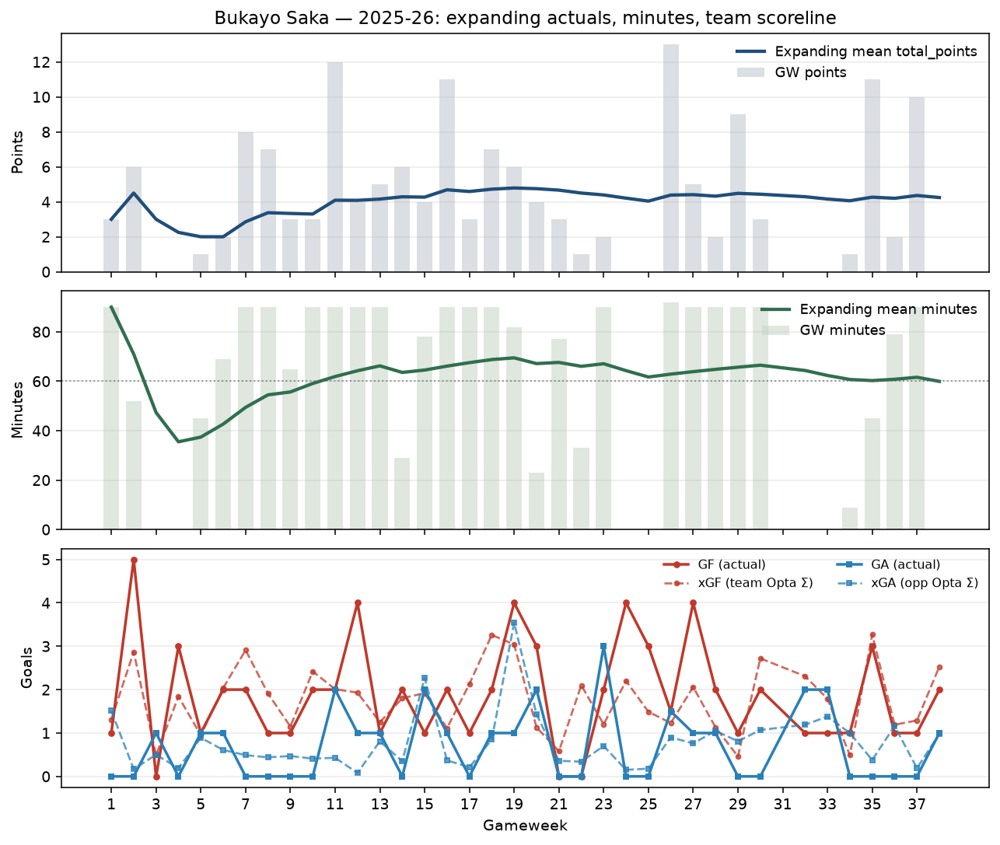

# Player expanding view — Bukayo Saka (2025-26)

Scorer-simplify dig: raw expanding actuals + GW team scoreline / xscoreline.
No shares, no pots, no renorm — just what the player and the match produced.

## Definitions

- **Expanding mean** of player GW totals through GW t (DGW rows summed into the GW).
- **GF / GA**: team scoreline for that GW (mean across fixtures if DGW).
- **xGF**: sum of team-mate `expected_goals` that fixture; **xGA**: opponent team Σ xG.

## Snapshot rows

| GW | minutes | exp_minutes | total_points | exp_total_points | goals | exp_goals | assists | exp_assists | clean_sheets | exp_clean_sheets | goals_conceded | exp_goals_conceded | gf | ga | team_xg | team_xga |
| --- | --- | --- | --- | --- | --- | --- | --- | --- | --- | --- | --- | --- | --- | --- | --- | --- |
| 1 | 90.00 | 90.00 | 3.00 | 3.00 | 0.00 | 0.00 | 0.00 | 0.00 | 1.00 | 1.00 | 0.00 | 0.00 | 1.00 | 0.00 | 1.31 | 1.51 |
| 5 | 45.00 | 37.40 | 1.00 | 2.00 | 0.00 | 0.20 | 0.00 | 0.00 | 0.00 | 0.20 | 0.00 | 0.00 | 1.00 | 1.00 | 0.95 | 0.89 |
| 10 | 90.00 | 59.10 | 3.00 | 3.30 | 0.00 | 0.20 | 0.00 | 0.00 | 1.00 | 0.50 | 0.00 | 0.10 | 2.00 | 0.00 | 2.42 | 0.41 |
| 15 | 78.00 | 64.53 | 4.00 | 4.27 | 0.00 | 0.27 | 1.00 | 0.13 | 0.00 | 0.33 | 1.00 | 0.40 | 1.00 | 2.00 | 1.92 | 2.27 |
| 20 | 23.00 | 67.15 | 4.00 | 4.75 | 0.00 | 0.20 | 1.00 | 0.35 | 0.00 | 0.35 | 1.00 | 0.45 | 3.00 | 2.00 | 1.13 | 1.43 |
| 25 | 0.00 | 61.72 | 0.00 | 4.04 | 0.00 | 0.16 | 0.00 | 0.28 | 0.00 | 0.32 | 0.00 | 0.48 | 3.00 | 0.00 | 1.49 | 0.18 |
| 30 | 90.00 | 66.50 | 3.00 | 4.43 | 0.00 | 0.20 | 0.00 | 0.27 | 1.00 | 0.33 | 0.00 | 0.53 | 2.00 | 0.00 | 2.72 | 1.07 |
| 35 | 45.00 | 60.26 | 11.00 | 4.26 | 1.00 | 0.21 | 1.00 | 0.26 | 0.00 | 0.29 | 0.00 | 0.47 | 3.00 | 0.00 | 3.27 | 0.38 |
| 38 | 0.00 | 59.95 | 0.00 | 4.24 | 0.00 | 0.19 | 0.00 | 0.27 | 0.00 | 0.32 | 0.00 | 0.43 | 2.00 | 1.00 | 2.53 | 0.98 |

Full CSV: `data/processed/player_expanding_view_saka_2025_26.csv`

## End-of-season expanding means

- minutes: **59.9**
- total_points: **4.24**
- goals: **0.19**
- assists: **0.27**
- clean_sheets: **0.32**
- goals_conceded: **0.43**

